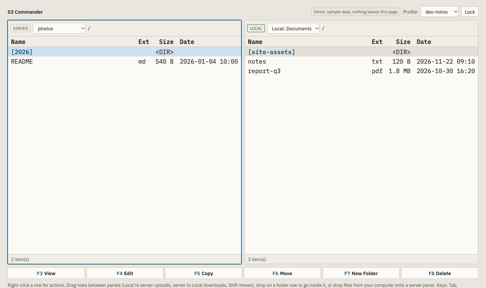
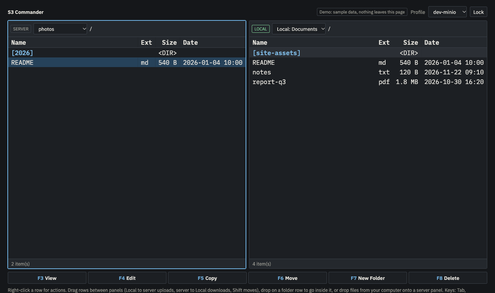
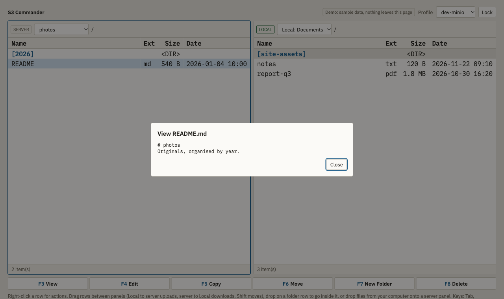

<p align="center">
  
</p>

<p align="center">
  <b>S3 Commander</b> — a Total Commander-style dual-pane file manager for MinIO and any S3-compatible server.
</p>

<p align="center">
  <a href="https://github.com/vinhduy11/s3-commander/releases/latest"><b>Download</b></a>
  &nbsp;·&nbsp;
  <a href="#features">Features</a>
  &nbsp;·&nbsp;
  <a href="#keyboard">Keyboard</a>
  &nbsp;·&nbsp;
  <a href="#build-and-run">Build and run</a>
  &nbsp;·&nbsp;
  <a href="#security">Security</a>
</p>

> **macOS first.** The builds are not code signed or notarized yet, so macOS blocks the first launch:
> right-click the app, choose Open, confirm (or `xattr -dr com.apple.quarantine "/Applications/S3 Commander.app"`).
> Linux builds exist but are untested. Please [open an issue](https://github.com/vinhduy11/s3-commander/issues) when something breaks.

<p align="center">
  
</p>

<p align="center">
  
  &nbsp;
  
</p>

<p align="center">
  <sub>Screenshots of the <a href="docs/artifact/2026-11-26-s3-commander-demo.html">interactive UI demo</a> (sample data, light and dark theme, F3 View).</sub>
</p>

S3 Commander is a Tauri 2 desktop app (Rust backend, React + TypeScript UI). Put a local folder on one side and a
bucket on the other, then copy, move and delete with the function keys like in Total Commander. It talks to a custom
endpoint per profile (MinIO and other S3-compatible servers), not only AWS.

## Features

- **Dual pane**: two independent panels, each a Local folder or a bucket of the active profile. Sortable Name, Ext,
  Size and Date columns, virtualised lists, a draggable splitter and resizable columns.
- **File operations**: F5 Copy, F6 Move, F7 New folder, F8 Delete, F2 Rename between Local and server panels, with a
  per-item conflict dialog. Drag and drop between panels, drop files from Finder or Explorer to upload, and a right-click menu.
- **Big transfers**: multipart upload (parts in parallel with retry, resume of a partly uploaded object) and ranged
  downloads through a `.part` file, up to the 5 TiB object limit. Jobs run in a queue with progress, speed, ETA,
  Cancel and Retry.
- **View and edit** (F3, F4): text, JSON (validate, format, minify) and CSV (a grid with in-place cell edit) with
  CodeMirror, saved safely: local saves are atomic, server saves refuse to overwrite an object changed meanwhile.
- **Presigned URLs**: copy or save a time-limited link for the marked objects (1 second to 7 days).
- **Go to path**: an editable path field with `~`, `s3://bucket/prefix` and `file://` syntax and recent locations;
  the last folder of each panel is remembered.
- **Light and dark theme** that follows the OS.
- **Selection**: range, toggle, invert, rubber band, and Select by pattern (`+` / `-`).
- **Profiles**: many profiles with a switcher, test connection, duplicate, and import of the non-secret settings
  from `~/.aws/config`.
- **Updates**: a quiet in-app check once per launch; updates are verified with a signature before install.

## Security

- Profile secrets live in an **encrypted vault** (Argon2id + XChaCha20-Poly1305) opened with a master key. The
  master key is never stored in plain text, and secret keys never go back to the UI.
- **Auto-lock** after idle, and a growing delay after failed unlocks.
- **Remember on this device** is opt-in and keeps only the derived vault key in the OS keychain, used at launch.
- Presigned URLs, secrets and credentials are never logged. The AWS CLI import never reads `~/.aws/credentials`.

Details and honest limits: [`docs/claude/safety.md`](docs/claude/safety.md).

## Keyboard

| Key | Action |
| --- | --- |
| F2 / F3 / F4 | Rename / View / Edit |
| F5 / F6 | Copy / Move to the other panel |
| F7 / F8 | New folder / Delete |
| Cmd or Ctrl+L | Go to path |
| Cmd or Ctrl+R | Reload the panel |
| Cmd or Ctrl+A, `*`, `+`, `-` | Mark all, invert, select / deselect by pattern |
| Space, Insert | Toggle the mark and move down |

## Build and run

Requirements: Node.js 22, a Rust toolchain, and the [Tauri 2 prerequisites](https://v2.tauri.app/start/prerequisites/)
for your OS.

```bash
npm install
npm run tauri dev      # run the desktop app
npm run build          # type-check + build the frontend
npm test               # vitest: stores, navigation, dialogs (mocked backend, no network)
cd src-tauri && cargo test   # vault, S3 helpers, transfer planner and engine (mocked SDK, tempdirs, no network)
npm run tauri build    # bundles (.dmg on macOS) in src-tauri/target/release/bundle
```

## Releases

Push a tag `vX.Y.Z` that matches the version in `package.json`, `src-tauri/Cargo.toml` and `src-tauri/tauri.conf.json`.
GitHub Actions builds the macOS (Apple Silicon and Intel) and Linux bundles and publishes the release with the updater
files. Steps, secrets and signing: [`docs/claude/deployment.md`](docs/claude/deployment.md). What changed in each
version: [`CHANGELOG.md`](CHANGELOG.md).

## Design notes

The design lives in [`docs/claude/`](docs/claude/): [architecture](docs/claude/architect.md),
[rules](docs/claude/rule.md), [safety](docs/claude/safety.md), [commands](docs/claude/commands.md) and
[deployment](docs/claude/deployment.md), [project structure](docs/claude/structure.md). An interactive UI demo is in [`docs/artifact/`](docs/artifact/).

## License

[MIT](LICENSE).

<sub>Not affiliated with MinIO, Inc. or Amazon Web Services. MinIO and Amazon S3 are trademarks of their owners.</sub>
